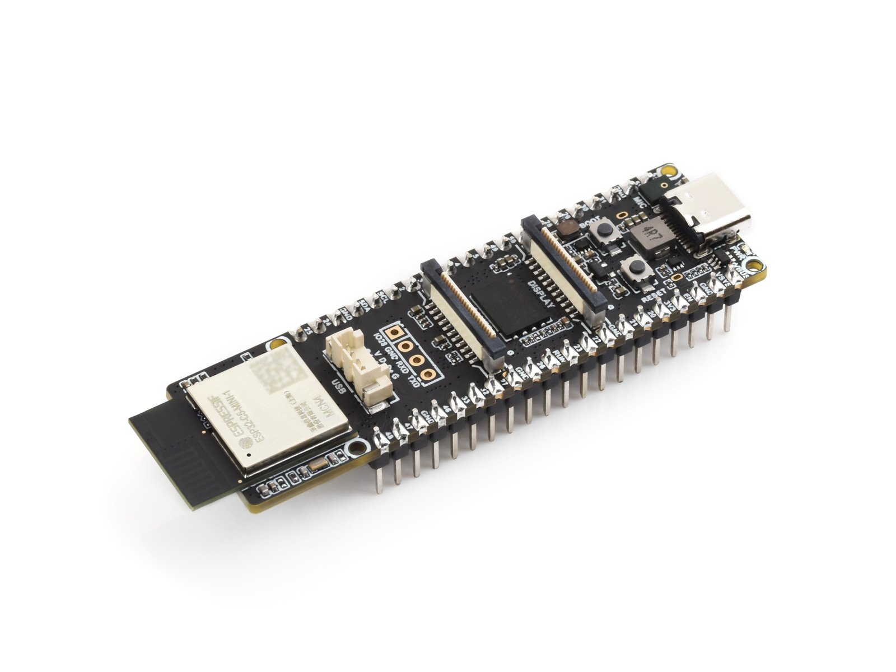

  <h1>ESP32-P4-WIFI6-DB</h1>
  
<strong>ESP32-P4 development board with an ESP32-C5 Wi-Fi 6 coprocessor and MIPI-DSI / MIPI-CSI interfaces</strong>

  
<strong>English</strong> | <a href="README_ZH.md">简体中文</a>

  

    
    
    
  

  

    <a href="https://www.waveshare.com/esp32-p4-wifi6-db.htm">🛒 Product</a> &middot;
    <a href="firmware/">📦 Firmware</a> &middot;
    <a href="examples/esp-idf/">🧩 ESP-IDF</a> &middot;
    <a href="examples/arduino/examples/">🔧 Arduino</a> &middot;
    <a href="https://www.waveshare.com/wiki/ESP32-P4-WIFI6-DB">📖 Documentation</a>
  

  

---

## ✨ Overview

The Waveshare ESP32-P4-WIFI6-DB is a multimedia development board powered by the ESP32-P4 main processor and an onboard ESP32-C5 wireless coprocessor over SDIO. This repository provides ESP-IDF and Arduino examples, open-source factory firmware, prebuilt factory binaries, and hardware schematics.

| Feature | Device / interface |
| --- | --- |
| MCU | ESP32-P4 (dual-core RISC-V up to 360 MHz + LP core), ESP32-C5 (Wi-Fi 6 / Bluetooth via SDIO) |
| Memory | 32 MB Flash, 32 MB PSRAM |
| Display | 2-lane MIPI-DSI (supports external 5, 7, 8, and 10.1-inch Waveshare DSI touch panels) |
| Touch | GT911 capacitive touch controller (I2C) |
| Camera | MIPI-CSI (OV5647) |
| Audio | ES8311 codec, analog microphone input, and speaker amplifier |
| Storage & expansion | microSD (4-bit SDMMC), USB Host, expansion GPIO |

### Supported Displays

| Panel | Controller | Resolution |
| --- | --- | --- |
| [Waveshare 5-DSI-TOUCH-A](https://www.waveshare.net/shop/5-DSI-TOUCH-A.htm) | HX8394, 5-inch | 720 × 1280 |
| [Waveshare 7-DSI-TOUCH-A](https://www.waveshare.net/shop/7-DSI-TOUCH-A.htm) | ILI9881C, 7-inch | 720 × 1280 |
| [Waveshare 8-DSI-TOUCH-A](https://www.waveshare.net/shop/8-DSI-TOUCH-A.htm) | JD9365, 8-inch | 800 × 1280 |
| [Waveshare 10.1-DSI-TOUCH-A](https://www.waveshare.net/shop/10.1-DSI-TOUCH-A.htm) | JD9365, 10.1-inch | 800 × 1280 |

Before building display examples, make sure the selected panel matches the connected display.

## 📦 Quick Start

The fastest way to try an example is a ready-to-flash package from the
[latest release](https://github.com/waveshareteam/ESP32-P4-WIFI6-DB/releases/latest).

1. Download the `*-combined.zip` package for the example and framework version you need.
2. Extract the archive and install esptool with `python -m pip install esptool`.
3. Connect the board over USB.
4. Run `flash_combined.bat COMx` on Windows or `./flash_combined.sh /dev/ttyACM0` on Linux.
5. Reset the board if it does not restart automatically.

Factory firmware (restores the out-of-box demo): download the matching panel file whose name contains `Factory` from the [`firmware`](firmware/) folder.

## 🧪 Examples

### ESP-IDF

| Example | Main feature |
| --- | --- |
| [00_board_check](examples/esp-idf/00_board_check/) | Chip, Flash, PSRAM, and serial-port check |
| [01_gpio_input](examples/esp-idf/01_gpio_input/) | Display GPIO input states on the LCD |
| [02_i2c_console](examples/esp-idf/02_i2c_console/) | Shared I2C bus scan and interactive diagnostics |
| [03_sdmmc](examples/esp-idf/03_sdmmc/) | microSD 4-bit SDMMC read/write test |
| [04_mipi_dsi](examples/esp-idf/04_mipi_dsi/) | MIPI-DSI LCD output and backlight test |
| [05_mipi_csi](examples/esp-idf/05_mipi_csi/) | OV5647 MIPI-CSI camera preview on the LCD |
| [06_wifi](examples/esp-idf/06_wifi/) | Wi-Fi connection through ESP32-C5 / ESP-Hosted |
| [07_i2s_codec](examples/esp-idf/07_i2s_codec/) | ES8311 audio playback, capture, and loopback |
| [08_usb_host_msc](examples/esp-idf/08_usb_host_msc/) | USB Host mass-storage test |
| [09_board_manager](examples/esp-idf/09_board_manager/) | ESP Board Manager bring-up console and test cases |

### Arduino

| Example | Main feature |
| --- | --- |
| [board_check](examples/arduino/examples/board_check/) | Chip, Flash, PSRAM, and serial-port check |
| [gpio](examples/arduino/examples/gpio/) | Expansion-header GPIO input monitor |
| [i2c](examples/arduino/examples/i2c/) | Shared I2C bus scan |
| [i2s](examples/arduino/examples/i2s/) | ES8311 audio playback and microphone test |
| [mipi_csi](examples/arduino/examples/mipi_csi/) | OV5647 MIPI-CSI camera preview on the LCD |
| [mipi_dsi](examples/arduino/examples/mipi_dsi/) | MIPI-DSI LCD and touch test |
| [sdmmc](examples/arduino/examples/sdmmc/) | microSD 4-bit SDMMC read/write test |

Board files for Arduino-ESP32 `3.3.11` are provided in [`examples/arduino/esp32`](examples/arduino/esp32/).

## 🛠️ Development Environment

| Framework | Version | Examples |
| --- | --- | ---: |
| ESP-IDF | `v5.5.6`, `v6.1.0` | 10 |
| Arduino-ESP32 | `3.3.11` | 7 |

## 📚 Resources

- [Schematic](hardware/schematic/)
- [Product page](https://www.waveshare.com/esp32-p4-wifi6-db.htm)
- [Wiki](https://www.waveshare.com/wiki/ESP32-P4-WIFI6-DB)

## 🤝 Support

- Example or repository problem: [open an issue](https://github.com/waveshareteam/ESP32-P4-WIFI6-DB/issues/new/choose).
- Product usage, hardware or order questions: [Waveshare support](https://service.waveshare.com/).

## 📄 License

Apache License 2.0. See [LICENSE](LICENSE).
