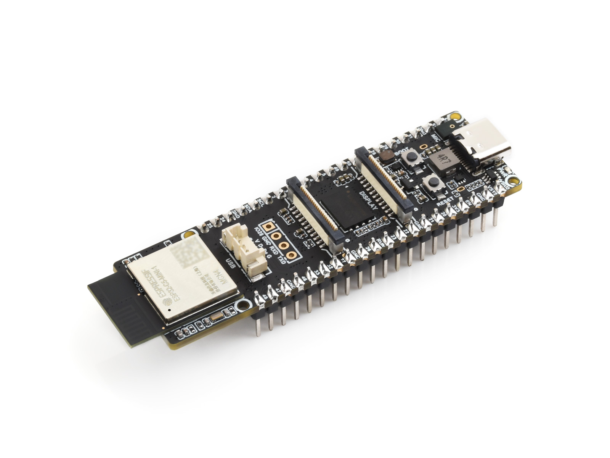

<div align="center">
  <h1>ESP32-P4-WIFI6-DB</h1>
  <p><strong>搭载 ESP32-C5 Wi-Fi 6 协处理器，提供 MIPI-DSI / MIPI-CSI 接口的 ESP32-P4 开发板</strong></p>
  <p>
    <a href="LICENSE"></a>
  </p>
  <p>
    <a href="README.md">English</a> ·
    <a href="https://www.waveshare.net/shop/ESP32-P4-WIFI6-DB.htm">🌐 产品页面</a> ·
    <a href="https://docs.waveshare.net/ESP32-P4-WIFI6-DB">📚 文档</a> ·
    <a href="firmware/">📦 固件</a> ·
    <a href="examples/esp_idf/">🧩 ESP-IDF 示例</a> ·
    <a href="examples/Arduino/">🔧 Arduino 示例</a>
  </p>
  
</div>

---

## ✨ 概述

本仓库提供 Waveshare ESP32-P4-WIFI6-DB 开发板的 ESP-IDF BSP、ESP-IDF 和 Arduino 示例、ESP-Brookesia 固件源码、出厂固件及原理图。

开发板采用 ESP32-P4 作为主控，并通过 SDIO 上的 ESP-Hosted 连接 ESP32-C5 无线协处理器，提供 MIPI-DSI 显示、MIPI-CSI 摄像头、ES8311 音频、microSD、USB Host、SPIFFS 和扩展 GPIO。显示屏和摄像头为外接模块，购买信息见[产品页面](https://www.waveshare.net/shop/ESP32-P4-WIFI6-DB.htm)。

## 🖥️ 硬件概览

| 功能 | 器件 / 接口 |
| --- | --- |
| 主处理器 | ESP32-P4，HP 系统双核 RISC-V，主频最高 360 MHz，并包含低功耗单核 |
| 无线 | ESP32-C5 协处理器，通过 SDIO 上的 ESP-Hosted 提供 Wi-Fi 6 和蓝牙 |
| 存储 | 32 MB Flash；Arduino 板卡定义启用 PSRAM |
| 显示 | 双通道 MIPI-DSI；支持外接 Waveshare 5、7、8、10.1 英寸面板 |
| 触摸 | GT911 电容触摸控制器，通过共享 I2C 总线轮询 |
| 摄像头 | MIPI-CSI；摄像头示例配置 OV5647 |
| 音频 | ES8311 编解码器、单路模拟麦克风输入和扬声器功放 |
| 存储与扩展 | microSD（4-bit SDMMC）、USB Host、SPIFFS 和扩展 GPIO |
| 板级支持 | 本地 ESP-IDF BSP 组件 `esp32_p4_wifi6_db`，版本 `0.0.1` |
| 原理图 | [hardware/ESP32-P4-WIFI6-DB.pdf](hardware/ESP32-P4-WIFI6-DB.pdf) |

### ESP-IDF LCD 选择

| 面板 | 控制器 | 分辨率 |
| --- | --- | --- |
| [Waveshare 5-DSI-TOUCH-A](https://www.waveshare.net/shop/5-DSI-TOUCH-A.htm) | HX8394，5 英寸 | 720 × 1280 |
| [Waveshare 7-DSI-TOUCH-A](https://www.waveshare.net/shop/7-DSI-TOUCH-A.htm) | ILI9881C，7 英寸 | 720 × 1280 |
| [Waveshare 8-DSI-TOUCH-A](https://www.waveshare.net/shop/8-DSI-TOUCH-A.htm) | JD9365，8 英寸 | 800 × 1280 |
| [Waveshare 10.1-DSI-TOUCH-A](https://www.waveshare.net/shop/10.1-DSI-TOUCH-A.htm) | JD9365，10.1 英寸 | 800 × 1280 |

构建前请确认所选面板与实际连接的面板匹配。

## 🚀 快速开始

安装 ESP-IDF（BSP manifest 要求 **>=5.5**）并打开已配置环境的终端，先构建板级自检示例：

```powershell
cd examples\esp_idf\00_board_check
idf.py set-target esp32p4
idf.py build
idf.py -p COMx flash monitor
```

将 `COMx` 替换为开发板的实际串口。自检通过后，可从下方示例表选择工程；构建显示示例前应配置与实际面板匹配的 LCD profile。Arduino 板卡包的安装步骤见 [Arduino 配置说明](examples/Arduino/README_CN.md)。

`>=5.5` 是组件清单的版本约束，不代表所有示例已在所有更新版本上验证；依赖组件还可能施加额外约束。

## 🧪 ESP-IDF 示例

| 示例 | 用途 |
| --- | --- |
| [00_board_check](examples/esp_idf/00_board_check) | 输出芯片、Flash、PSRAM 和串口信息 |
| [01_gpio_input](examples/esp_idf/01_gpio_input) | 在 LCD 上显示 GPIO 输入状态 |
| [02_i2c_console](examples/esp_idf/02_i2c_console) | 共享 I2C 总线扫描和交互式诊断 |
| [03_sdmmc](examples/esp_idf/03_sdmmc) | microSD 4-bit SDMMC 读写测试 |
| [04_mipi_dsi](examples/esp_idf/04_mipi_dsi) | MIPI-DSI LCD 输出和背光测试 |
| [05_mipi_csi](examples/esp_idf/05_mipi_csi) | 摄像头 LCD 预览 |
| [06_wifi](examples/esp_idf/06_wifi) | 通过 ESP32-C5 / ESP-Hosted 连接 Wi-Fi |
| [07_i2s_codec](examples/esp_idf/07_i2s_codec) | ES8311 音频播放、采集和回环 |
| [08_usb_host_msc](examples/esp_idf/08_usb_host_msc) | USB Host 大容量存储测试 |
| [09_board_manager](examples/esp_idf/09_board_manager) | ESP Board Manager 初始化控制台和测试用例 |

接线和操作方法请查看各示例目录中的 README 及配置。

## 🧪 Arduino 示例

本地板卡包面向 Arduino-ESP32 **3.3.11**。按 [Arduino 配置说明](examples/Arduino/README_CN.md) 安装 variant 和板卡条目，然后选择 `Waveshare ESP32-P4-WIFI6-DB`。板卡默认使用 32 MB Flash 和 `default_32MB` 分区方案；各示例所需配置见对应 README。

| 示例 | 用途 |
| --- | --- |
| [board_check](examples/Arduino/board_check) | 芯片和内存信息 |
| [gpio](examples/Arduino/gpio) | 串口交互式 GPIO 测试 |
| [i2c](examples/Arduino/i2c) | I2C1 地址扫描 |
| [i2s](examples/Arduino/i2s) | ES8311 单麦克风到单扬声器音频回环 |
| [sdmmc](examples/Arduino/sdmmc) | 4-bit microSD 文件读写 |
| [mipi_dsi](examples/Arduino/mipi_dsi) | LCD 色条和背光测试 |
| [mipi_csi](examples/Arduino/mipi_csi) | OV5647 摄像头 LCD 预览 |

使用其他 LCD 时，请在示例配置中选择与所接面板匹配的选项。I2C1 由多个外设共用，在同一程序中初始化一次即可。

## 📡 ESP32-P4 与 ESP32-C5 无线

ESP32-P4 本身不集成射频。Wi-Fi 和蓝牙由 ESP32-C5 协处理器通过 SDIO 上的 ESP-Hosted 提供。ESP32-C5 需要兼容的从机固件；烧录 ESP32-P4 示例不会更新 C5。修改或重新烧录协处理器前，请确认从机固件与 P4 工程使用的 ESP-Hosted 和远程 Wi-Fi 组件版本兼容。

## 📦 固件

[`firmware/brookesia/`](firmware/brookesia/) 包含 ESP-Brookesia 应用固件源码，包括图形界面、设置、音乐播放器、视频播放器、摄像头和其他应用组件。

[`firmware/factory-firmware/`](firmware/factory-firmware/) 提供 ESP32-P4 主控和 ESP32-C5 无线协处理器的预编译固件。两者目标芯片和烧录地址不同，烧录前请核对对应说明及固件版本；仓库中存在固件文件不代表它与重新解析的依赖版本兼容。

## 🗂️ 仓库目录

| 路径 | 内容 |
| --- | --- |
| [`components/waveshare_bsp/esp32_p4_wifi6_db/`](components/waveshare_bsp/esp32_p4_wifi6_db/) | ESP-IDF BSP、头文件、Kconfig 和组件清单 |
| [`components/waveshare_bmgr/`](components/waveshare_bmgr/) | ESP Board Manager 板卡定义和 LCD amends |
| [`examples/esp_idf/`](examples/esp_idf/) | ESP-IDF 外设和功能示例 |
| [`examples/Arduino/`](examples/Arduino/) | Arduino 示例及本地板卡定义 |
| [`firmware/brookesia/`](firmware/brookesia/) | ESP-Brookesia 应用固件源码 |
| [`firmware/factory-firmware/`](firmware/factory-firmware/) | ESP32-P4 和 ESP32-C5 预编译固件 |
| [`hardware/`](hardware/) | 开发板原理图 |
| [`docs/`](docs/) | 硬件参考和项目文档 |
| [`asserts/`](asserts/) | 文档使用的产品图片 |

## 📚 文档

- [产品页面](https://www.waveshare.net/shop/ESP32-P4-WIFI6-DB.htm)
- [官方 Wiki](https://docs.waveshare.net/ESP32-P4-WIFI6-DB)
- [BSP README](components/waveshare_bsp/esp32_p4_wifi6_db/README_CN.md)
- [BSP API 参考](components/waveshare_bsp/esp32_p4_wifi6_db/API_CN.md)
- [Arduino 示例](examples/Arduino/README_CN.md)
- [Brookesia 固件](firmware/brookesia/README_CN.md)
- [原理图](hardware/ESP32-P4-WIFI6-DB.pdf)

## 🤝 支持与贡献

欢迎提交贡献和可复现的问题报告。请附上开发板版本、所接面板、示例路径、ESP-IDF 或 Arduino-ESP32 版本、复现步骤、预期行为、实际行为和相关串口日志；请勿提交包含 Wi-Fi 密码或 API key 的日志。

- [提交 Issue](https://github.com/waveshareteam/ESP32-P4-WIFI6-DB/issues/new)

## 📄 许可证

本仓库采用 Apache License 2.0 许可，详见 [LICENSE](LICENSE)。部分组件和示例文件另有许可证或版权声明；使用和再分发这些文件时，也应遵循相应声明。
