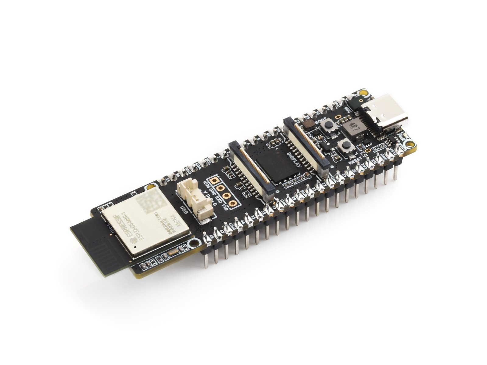

  <h1>ESP32-P4-WIFI6-DB</h1>
  
<strong>搭载 ESP32-C5 Wi-Fi 6 协处理器及 MIPI-DSI / MIPI-CSI 接口的 ESP32-P4 开发板</strong>

  
<a href="README.md">English</a> | <strong>简体中文</strong>

  

    
    
    
  

  

    <a href="https://www.waveshare.net/shop/ESP32-P4-WIFI6-DB.htm">🛒 产品</a> &middot;
    <a href="firmware/">📦 固件</a> &middot;
    <a href="examples/esp-idf/">🧩 ESP-IDF</a> &middot;
    <a href="examples/arduino/examples/">🔧 Arduino</a> &middot;
    <a href="https://docs.waveshare.net/ESP32-P4-WIFI6-DB/">📖 文档</a>
  

  

---

## ✨ 概述

**ESP32-P4-WIFI6-DB** 是一款基于 ESP32-P4 处理器与 ESP32-C5 Wi-Fi 6 / BLE 无线协处理器的开发板，集成双 lane MIPI-DSI 显示与 GT911 触摸、MIPI-CSI 摄像头、ES8311 音频编解码、microSD 卡槽、USB Host 及扩展排针 GPIO。

本仓库提供配套的 ESP-IDF 示例、包含本地板卡定义的 Arduino 示例、ESP-Brookesia 出厂固件源码、预编译出厂固件以及硬件原理图。建议先运行 [00_board_check](examples/esp-idf/00_board_check/) 示例，确认编译、烧录与串口监视流程正常。

| 功能 | 器件或接口 |
| --- | --- |
| MCU | ESP32-P4（双核高性能 RISC-V + 低功耗核） |
| 无线连接 | ESP32-C5 无线协处理器（支持 Wi-Fi 6 & BLE，4-bit SDIO） |
| 存储器 | 板载 32 MB Flash 与 32 MB PSRAM |
| 显示接口 | 双 lane MIPI-DSI 接口，I2C 背光控制（支持 [5-DSI-TOUCH-A](https://www.waveshare.net/shop/5-DSI-TOUCH-A.htm)、[7-DSI-TOUCH-A](https://www.waveshare.net/shop/7-DSI-TOUCH-A.htm)、[8-DSI-TOUCH-A](https://www.waveshare.net/shop/8-DSI-TOUCH-A.htm)、[10.1-DSI-TOUCH-A](https://www.waveshare.net/shop/10.1-DSI-TOUCH-A.htm)） |
| 触摸 | GT911 电容触摸（I2C 接口） |
| 摄像头 | 板载 MIPI-CSI 接口，支持 OV5647（[RPi Camera (B)](https://www.waveshare.net/shop/RPi-Camera-B.htm)）摄像头模组 |
| 音频 | ES8311 音频编解码芯片（I2C + I2S），支持扬声器功放与模拟麦克风输入 |
| 扩展存储 | 板载 microSD 卡槽，通过 4-bit SDMMC 接口高速读写 |
| USB | USB Host（USB-C OTG 接口） |
| 扩展接口 | 扩展排针 GPIO |

编译显示相关示例前，请确认所选屏幕型号与实物一致（ESP-IDF 示例在 `idf.py menuconfig` 的 `Board Support Package` 中选择，Arduino 示例在代码中选择）。

### ESP32-P4 与 ESP32-C5 无线

ESP32-P4 本身不集成射频，Wi-Fi 6 和蓝牙由板载 ESP32-C5 协处理器通过 SDIO 上的 ESP-Hosted 提供。开发板出厂时已在 ESP32-C5 中预烧兼容的从机固件，烧录 ESP32-P4 示例不会影响 C5。仓库中提供了一份预编译从机固件 [`firmware/ESP32-C5/esp32-c5-slave-260623.bin`](firmware/ESP32-C5/esp32-c5-slave-260623.bin)；如果修改或升级了 P4 工程的 ESP-Hosted 组件版本，需基于官方仓库 [espressif/esp-hosted-mcu](https://github.com/espressif/esp-hosted-mcu) 编译对应版本的从机固件。

## 📦 快速开始

体验示例最快的方法是使用[最新版本](https://github.com/waveshareteam/ESP32-P4-WIFI6-DB/releases/latest)中打包好的可烧录固件。

1. 下载所需示例和框架版本对应的 `*-combined.zip`。
2. 解压后通过 `python -m pip install esptool` 安装 esptool。
3. 通过 USB 连接开发板。
4. Windows 运行 `flash_combined.bat COMx`，Linux 运行 `./flash_combined.sh /dev/ttyACM0`。
5. 如果开发板未自动重启，请手动复位。

出厂固件（恢复开箱演示）：在 [`firmware`](firmware/) 目录下载对应屏幕型号且文件名带 `Factory` 的文件。

## 🧪 示例

### ESP-IDF

| 示例 | 主要功能 |
| --- | --- |
| [00_board_check](examples/esp-idf/00_board_check/) | 芯片、Flash、PSRAM 与串口基础检测 |
| [01_gpio_input](examples/esp-idf/01_gpio_input/) | 在屏幕上实时显示 GPIO 输入状态 |
| [02_i2c_console](examples/esp-idf/02_i2c_console/) | 共享 I2C 总线扫描与交互诊断 |
| [03_sdmmc](examples/esp-idf/03_sdmmc/) | microSD 4 位 SDMMC 读写测试 |
| [04_mipi_dsi](examples/esp-idf/04_mipi_dsi/) | MIPI-DSI 屏幕显示与背光测试 |
| [05_mipi_csi](examples/esp-idf/05_mipi_csi/) | OV5647 MIPI-CSI 摄像头画面预览 |
| [06_wifi](examples/esp-idf/06_wifi/) | 通过 ESP32-C5 / ESP-Hosted 连接 Wi-Fi |
| [07_i2s_codec](examples/esp-idf/07_i2s_codec/) | ES8311 音频播放、录音与回环测试 |
| [08_usb_host_msc](examples/esp-idf/08_usb_host_msc/) | USB Host 大容量存储设备读写测试 |
| [09_board_manager](examples/esp-idf/09_board_manager/) | ESP Board Manager 板级初始化与外设测试 |

### Arduino

| 示例 | 主要功能 |
| --- | --- |
| [board_check](examples/arduino/examples/board_check/) | 芯片、Flash、PSRAM 与串口基础检测 |
| [gpio](examples/arduino/examples/gpio/) | 扩展排针 GPIO 输入状态监测 |
| [i2c](examples/arduino/examples/i2c/) | 共享 I2C 总线扫描 |
| [i2s](examples/arduino/examples/i2s/) | ES8311 音频播放与麦克风测试 |
| [mipi_csi](examples/arduino/examples/mipi_csi/) | OV5647 MIPI-CSI 摄像头画面预览 |
| [mipi_dsi](examples/arduino/examples/mipi_dsi/) | MIPI-DSI 屏幕显示与触摸测试 |
| [sdmmc](examples/arduino/examples/sdmmc/) | microSD 4 位 SDMMC 读写测试 |

Arduino-ESP32 `3.3.11` 的板级支持文件位于 [`examples/arduino/esp32`](examples/arduino/esp32/)。

## 🛠️ 开发环境

| 开发框架 | 版本 | 示例数 |
| --- | --- | ---: |
| ESP-IDF | `v5.5.6`、`v6.1.0` | 10 |
| Arduino-ESP32 | `3.3.11` | 7 |

## 📚 资料

- [原理图](hardware/schematic/)
- [产品页](https://www.waveshare.net/shop/ESP32-P4-WIFI6-DB.htm)
- [Wiki](https://docs.waveshare.net/ESP32-P4-WIFI6-DB/)

## 🤝 支持

- 产品使用、硬件或订单问题：[微雪技术支持](https://docs.waveshare.net/ESP32-P4-WIFI6-DB/Technical-Support/)。

## 📄 许可证

Apache License 2.0，详见 [LICENSE](LICENSE)。
